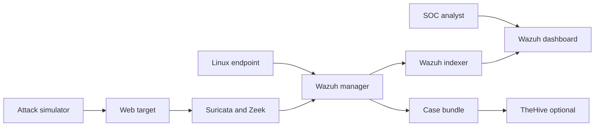

<div align="center">

# 🛡️ Enterprise SOC Lab
### Detection Engineering · Network Telemetry · Incident Response


**From controlled ATT&CK-aligned activity to telemetry, detection and analyst investigation.**

[Architecture](docs/architecture/architecture.md) · [Detection catalogue](detections/catalog.yml) · [Playbooks](docs/playbooks) · [My cybersecurity portfolio](docs/portfolio/github-projects.md)

</div>

---


Laboratoire SOC d'entreprise reproductible avec Docker Compose. Il relie un
SIEM/EDR Wazuh, une cible web volontairement vulnérable, Suricata, Zeek, des
détections personnalisées, trois émulations MITRE ATT&CK, une chaîne de preuves
et un profil TheHive optionnel.

> Usage local et pédagogique uniquement. Les scénarios sont confinés aux
> réseaux Docker du lab; n'utilisez jamais ce dépôt contre une cible tierce.

## Ce que le projet démontre

- architecture SOC et segmentation par frontières de confiance;
- collecte endpoint Wazuh, FIM, inventaire et événements d'authentification;
- détection réseau Suricata et métadonnées Zeek sur le trafic réel de la cible;
- detection-as-code avec mappings ATT&CK et tests de contrat;
- triage, génération de preuves et création d'un bundle de cas TheHive;
- secrets locaux, TLS interne, moindre privilège et contrôles CI.

## Architecture rapide



La conception détaillée se trouve dans
[docs/architecture/architecture.md](docs/architecture/architecture.md).

## Prérequis

- Linux x86_64 ou Docker Desktop avec intégration WSL2 activée;
- Docker Engine 25+ et Docker Compose v2;
- Python 3.11+;
- 4 CPU, 16 Go RAM et 50 Go disque pour `core,network`;
- 32 Go RAM recommandés avec le profil `cases`.

Sous Docker Desktop: **Settings → Resources → WSL Integration**, activez la
distribution qui contient ce dépôt. Wazuh exige aussi:

```bash
sudo sysctl -w vm.max_map_count=262144
```

## Démarrage

```bash
python3 -m pip install -r requirements-dev.txt
make bootstrap
make validate
make test
make up PROFILE=core,network
make health PROFILE=core,network
```

Interfaces locales:

| Service | URL | Accès |
|---|---|---|
| Wazuh | <https://127.0.0.1:8443> | utilisateur `admin`, mot de passe `WAZUH_INDEXER_PASSWORD` dans `.env` |
| Juice Shop | <http://127.0.0.1:3000> | cible du lab uniquement |
| TheHive | <http://127.0.0.1:9000> | uniquement avec le profil `cases`; initialisation au premier lancement |

Le certificat Wazuh est auto-signé; l'avertissement navigateur est attendu.

## Profils

| Profil | Contenu | RAM indicative |
|---|---|---:|
| `core` | Wazuh, endpoint simulé, cible web | 8–12 Go |
| `network` | Suricata et Zeek partageant le namespace de la cible | 2–4 Go |
| `attack` | conteneur curl one-shot; démarré seulement par un scénario | < 100 Mo |
| `cases` | TheHive, Cassandra et Elasticsearch | 6–8 Go supplémentaires |
| `intel` | feed MISP-compatible local et IOC CDB Wazuh | < 100 Mo |

Le conteneur agent représente un **endpoint Linux simulé**; il ne surveille pas
l'hôte Docker. Le guide d'exploitation explique comment ajouter une vraie VM.

## Scénarios

```bash
make simulate SCENARIO=ssh-bruteforce
make simulate SCENARIO=web-recon
make simulate SCENARIO=persistence-artifact
make case SCENARIO=ssh-bruteforce
```

| Scénario | ATT&CK | Signal principal |
|---|---|---|
| `ssh-bruteforce` | T1110.001 | corrélation d'échecs SSH |
| `web-recon` | T1595.002 / T1190 | Suricata + Zeek |
| `persistence-artifact` | T1546 | Wazuh FIM |

Chaque exécution écrit une preuve horodatée sous `runtime/evidence/`, ignorée
par Git. Consultez les [playbooks analyste](docs/playbooks) pour les étapes de
qualification et de réponse aux alertes.

## Commandes utiles

```bash
make help
make config PROFILE=core,network,cases
make health PROFILE=core,network
make down                         # conserve données et preuves
make destroy CONFIRM_DESTROY=yes # destructif: supprime les volumes
```

## Garanties et limites

- Les ports publiés écoutent seulement sur `127.0.0.1`.
- Le réseau d'attaque est `internal: true`; aucun hostname cible n'est accepté.
- Aucun conteneur ne monte `/var/run/docker.sock` ou le système de fichiers hôte.
- L'IPS inline n'est pas activé: Suricata fonctionne en IDS passif dans le
  namespace de la cible. Le présenter comme un IPS de production serait inexact.
- Cortex est volontairement absent du chemin automatique car son mode standard
  exécute des analyseurs via le socket Docker.
- Le profil `intel` est un feed MISP-compatible pédagogique, pas un serveur MISP
  complet. Une instance MISP externe peut consommer/produire le même format.
- Les images sont versionnées, mais pas encore verrouillées par digest; voir le
  [threat model](soc-threat-model.md) pour le risque résiduel supply-chain.

## Documentation

- [Spécification](docs/specification.md)
- [Architecture et flux](docs/architecture/architecture.md)
- [Threat model](soc-threat-model.md)
- [Runbook opérateur](docs/runbooks/operations.md)

Les topologies Wazuh sont adaptées de la documentation Docker officielle
Wazuh `v4.14.10`; les sources et licences sont consignées dans [NOTICE.md](NOTICE.md).

## 👤 Author and cybersecurity portfolio

**Yousef Gaddah** — Cybersecurity & Cloud Computing Engineering Student, ENIM – Mines Rabat.

- [Curated technical project index](docs/portfolio/github-projects.md) — SOC, CTI, Cloud Security, DevSecOps, and security automation.
- [GitHub profile README template](docs/portfolio/GITHUB_PROFILE_README.md) — prepared for the dedicated GitHub profile repository.
- [LinkedIn](https://www.linkedin.com/in/yousef-gaddah) · [GitHub](https://github.com/gaddah-yousef)

> This lab is an educational, locally scoped design. Read the documented limitations and validate runtime behavior before making claims about its deployment.
