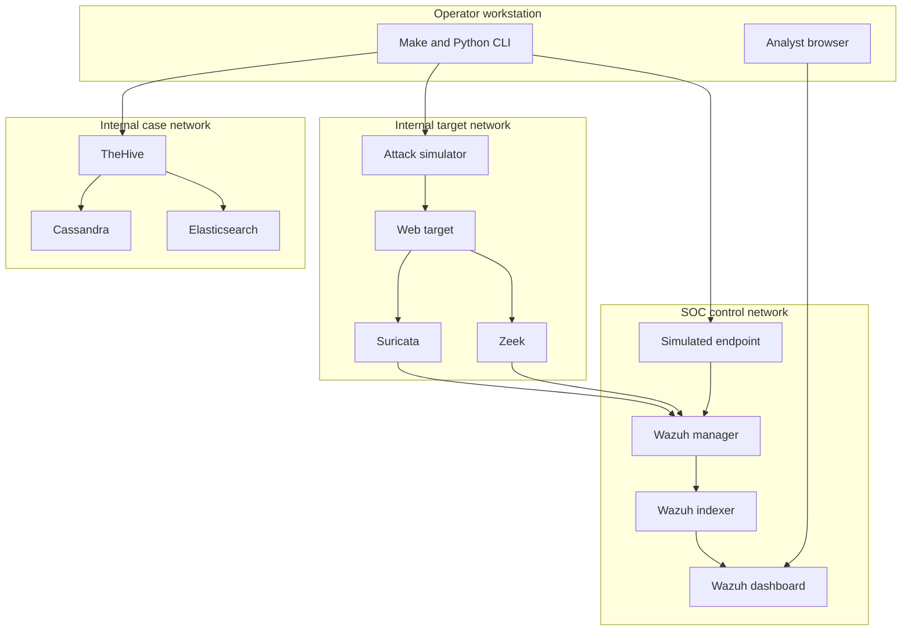

# Architecture technique

## Objectif de conception

Le chemin principal doit relier une action simulée à une preuve réseau ou
endpoint, une détection Wazuh et un cas analyste, sans donner au simulateur un
accès au LAN, à Internet, au socket Docker ou au système de fichiers hôte.

## Zones et flux

### Frontières de confiance

| Bord | Données | Canal | Contrôles |
|---|---|---|---|
| Opérateur → CLI | scénario allowlisté | argument local | `argparse` avec `choices`, aucune cible arbitraire |
| Simulateur → cible | requête HTTP synthétique | réseau Docker interne | URL fixe, `cap_drop: ALL`, FS read-only |
| Cible → capteurs | paquets web | namespace réseau partagé | capteurs passifs; pas de réseau hôte |
| Capteurs → manager | EVE/Zeek JSON | bind mounts runtime read-only côté Wazuh | chemins fixes, parseur JSON Wazuh |
| Endpoint → manager | logs, FIM, inventaire | protocole agent Wazuh TCP 1514 | enrôlement protégé par secret, chiffrement agent |
| Manager → indexer | alertes | HTTPS interne | certificats générés, authentification locale |
| Navigateur → UI | recherches et administration | HTTPS loopback 8443 | compte administrateur local; certificat auto-signé |
| Bundle → TheHive | JSON de cas | import manuel local | revue humaine avant import; aucun token versionné |

## Choix importants

1. **Namespace cible partagé.** Un capteur placé comme simple pair sur un bridge
   Docker ne voit pas nécessairement les paquets des autres veth. Suricata et
   Zeek utilisent donc `network_mode: service:web-target`.
2. **Profiles.** Wazuh est le chemin principal. Les capteurs et TheHive sont
   activables séparément pour contrôler consommation et surface d'attaque.
3. **Secrets générés.** `.env`, hashes bcrypt, certificats, télémétrie et preuves
   restent sous des chemins ignorés par Git.
4. **Pas de Cortex automatique.** Le socket Docker créerait une frontière de
   privilège disproportionnée pour un lab local.
5. **IDS, pas faux IPS.** L'inspection passive est fonctionnelle; un vrai inline
   IPS nécessiterait routage/NFQUEUE et autorisation sur le pare-feu de l'hôte.

## Données persistantes

- Volumes Wazuh: index, configuration, files d'attente et dashboard.
- `runtime/telemetry`: journaux endpoint, Suricata et Zeek.
- `runtime/evidence`: manifeste de chaque simulation et bundle de cas.
- Volumes TheHive: Cassandra, Elasticsearch, pièces jointes et logs.

`make down` préserve ces données. Seul `make destroy CONFIRM_DESTROY=yes` les
supprime explicitement.
