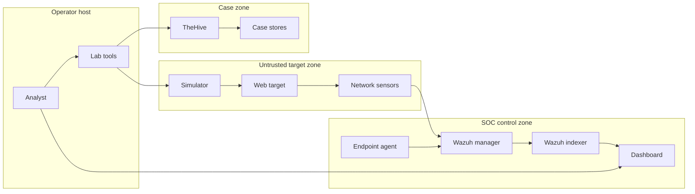

# Enterprise SOC Lab — threat model

## Executive summary

The highest risks are accidental exposure of intentionally vulnerable services,
theft of local SOC credentials, and compromise through mutable third-party image
tags. The design materially reduces remote attack likelihood through loopback
publishing, internal Docker networks, fixed scenario targets and denial of Docker
socket access. Residual risk remains because the workstation is the security
boundary and the images are version-pinned but not digest-pinned.

## Scope and assumptions

- In scope: `compose.yaml`, `scripts/`, `config/`, `detections/`, `scenarios/`
  and operator workflows in `Makefile`.
- Intended use: one analyst on a local Linux/WSL2 workstation with synthetic data.
- Exposure: loopback only; no port forwarding, public reverse proxy or shared host.
- Data sensitivity: generated credentials and synthetic security telemetry; no
  production logs, personal data, customer IOC or real malware.
- Out of scope: Docker daemon compromise, third-party product internals, a
  production multi-user deployment and inline host IPS.
- These assumptions were validated through the approved project specification
  and the instruction to build a local Docker portfolio lab.

Open questions that would change ranking: none for the documented deployment.
Publishing any port beyond loopback or ingesting real enterprise data requires a
new threat assessment.

## System model

### Primary components

- Operator CLIs generate secrets, render config, execute allowlisted simulations
  and build case bundles (`scripts/bootstrap.py`, `scripts/simulate.py`).
- Wazuh manager/indexer/dashboard collect, correlate and display endpoint and
  sensor data (`compose.yaml`, `config/wazuh-manager/ossec.conf`).
- A simulated Wazuh agent monitors generated auth logs and FIM paths
  (`config/wazuh-agent/ossec.conf`).
- Juice Shop is the lab target; Suricata and Zeek observe its shared network
  namespace (`compose.yaml`, services `web-target`, `suricata`, `zeek`).
- TheHive, Cassandra and Elasticsearch form an optional case zone
  (`compose.yaml`, profile `cases`).

### Data flows and trust boundaries

- Operator → bootstrap: local arguments and filesystem paths → Python/file I/O;
  operator trust, exclusive `.env` creation, restrictive mode where supported.
- Operator → simulator: scenario slug → Python CLI; exact `argparse` allowlist,
  fixed actions and no command shell (`scripts/simulate.py`).
- Simulator → target: synthetic HTTP → internal Docker bridge; fixed service URL,
  read-only image, all capabilities dropped (`compose.yaml`).
- Target → sensors: untrusted packets → shared network namespace; passive parsing,
  only `NET_RAW`/`NET_ADMIN` granted to named sensors.
- Sensors → manager: attacker-influenced JSON logs → read-only bind mounts and
  Wazuh JSON parser; no schema signature or trust label.
- Endpoint → manager: generated logs/FIM → Wazuh agent protocol; enrollment
  password and encrypted agent transport.
- Manager → indexer/dashboard: alerts and credentials → internal HTTPS; locally
  generated certificates and bcrypt credentials.
- Browser → dashboards: administrative requests → loopback HTTPS/HTTP; host user
  and product authentication are the effective boundary.
- Evidence → case bundle/TheHive: JSON → local file/manual import; human review,
  no automatic API key or responder execution.

#### Diagram

## Assets and security objectives

| Asset | Why it matters | Security objective (C/I/A) |
|---|---|---|
| `.env` credentials | grants administrative/product access | C, I |
| TLS private keys | protects internal service identity | C, I |
| Wazuh indices and rules | basis for detection and investigation | I, A |
| Raw telemetry and evidence | supports timeline and analyst conclusions | I, A |
| Docker host resources | compromise escapes the educational boundary | C, I, A |
| Case records | preserve decisions and lessons learned | I, A |
| Compose/image supply chain | executes code with sensor capabilities | I |

## Attacker model

### Capabilities

- A malicious HTTP client can influence target traffic and resulting sensor logs
  if it can access loopback through the operator's session.
- A local unprivileged user or malicious desktop process may read files permitted
  by host/DrvFS ACLs and connect to loopback services.
- A compromised third-party image can act with the container's granted network,
  filesystem and capability set.
- An operator can misconfigure bindings or run destructive Make targets.

### Non-capabilities

- A remote Internet attacker cannot directly route to internal Docker networks
  in the documented topology.
- The simulator cannot choose an arbitrary hostname, join the host network or
  access the Docker socket.
- The lab does not process real malware, arbitrary uploaded analyzers or
  multi-tenant production data.

## Entry points and attack surfaces

| Surface | How reached | Trust boundary | Notes | Evidence |
|---|---|---|---|---|
| Wazuh dashboard | loopback 8443 | browser → SOC | self-signed TLS and local login | `compose.yaml` / `wazuh-dashboard.ports` |
| Wazuh API/indexer | loopback 55000/9200 | host → SOC | generated credentials | `compose.yaml` |
| Juice Shop | loopback 3000 | browser → vulnerable target | intentionally vulnerable | `compose.yaml` / `web-target` |
| TheHive | loopback 9000 | browser → case zone | optional, first-run setup | `compose.yaml` / `thehive` |
| Scenario CLI | local argument | operator → tooling | fixed slug choices | `scripts/simulate.py::parse_arguments` |
| Telemetry parsers | mounted JSON/syslog | target/sensors → Wazuh | attacker-influenced content | `config/wazuh-manager/ossec.conf` |
| Secret bootstrap | local filesystem | tooling → host | no rotation on repeat | `scripts/bootstrap.py` |
| Image pull/start | registries via Docker | supply chain → runtime | explicit tags, no digests | `compose.yaml` / `image` keys |

## Top abuse paths

1. Operator changes `127.0.0.1` to a wildcard → vulnerable Juice Shop becomes
   LAN-accessible → attacker exploits it and consumes host resources.
2. Local malware reads `.env` → logs into Wazuh/TheHive → deletes or falsifies
   investigation state and detection configuration.
3. Registry tag is replaced or account compromised → Docker pulls malicious
   sensor image → image uses `NET_ADMIN`/`NET_RAW` inside the target namespace.
4. Attacker sends crafted/high-volume HTTP → Suricata/Zeek generate large logs →
   Wazuh/index storage and workstation memory are exhausted.
5. Crafted log fields mimic lab signatures → false positive case created → analyst
   trusts poisoned evidence without comparing raw packet/application context.
6. Operator imports real secrets/logs into runtime → workstation backup/sync leaks
   data that was assumed synthetic and disposable.
7. A future Cortex integration mounts Docker socket → analyzer compromise controls
   the Docker daemon → host-level impact; current design intentionally omits it.

## Threat model table

| Threat ID | Threat source | Prerequisites | Threat action | Impact | Impacted assets | Existing controls (evidence) | Gaps | Recommended mitigations | Detection ideas | Likelihood | Impact severity | Priority |
|---|---|---|---|---|---|---|---|---|---|---|---|---|
| TM-001 | Remote/LAN attacker | Operator broadens a published binding or adds port forwarding. | Exploit intentionally vulnerable or administrative service. | Target compromise, data alteration, workstation DoS. | Host resources, Wazuh data | Loopback policy and validator (`scripts/validate.py::validate_compose`). | Docker/OS changes outside repo are not observed. | Keep firewall deny rules; rerun `make validate`; never reverse-proxy this lab. | Alert on non-loopback listeners with `ss`; review Docker port mappings. | Low | High | medium |
| TM-002 | Local malware/user | Read access to project files or Windows ACL. | Steal `.env` and private keys, then administer SOC services. | Detection tampering and case loss. | Credentials, indices, cases | `.gitignore`, generated random secrets, mode 0600 where supported (`scripts/bootstrap.py`). | DrvFS permissions may not enforce Unix mode; secrets remain plaintext. | Store project in WSL ext4 or use a local secret manager; rotate after demos. | File-access auditing and unexpected Wazuh login review. | Medium | High | high |
| TM-003 | Supply-chain attacker | Registry/repository compromise or malicious retag. | Ship code under an existing version tag. | Container execution and telemetry compromise. | Host resources, detection integrity | Explicit version tags and source notice (`compose.yaml`, `NOTICE.md`). | No digest pins, signatures or SBOM verification. | Pin multi-arch digests; verify Cosign where publishers support it; schedule image scanning. | Compare resolved digests in CI; alert on unexpected changes. | Medium | High | high |
| TM-004 | Target-side attacker | Ability to issue requests to the lab target. | Poison JSON/log fields or flood detections. | False cases, missed signals, analyst confusion. | Telemetry, rules, cases | Multiple sensors, raw evidence paths, manual case review. | No signed telemetry or formal schema validation before Wazuh. | Correlate endpoint/network sources; preserve raw logs; add rate/size limits. | Volume baselines, parser-error alerts, source cross-checks. | Medium | Medium | medium |
| TM-005 | Local or target-side actor | Sustained traffic or all profiles enabled on constrained host. | Exhaust CPU, memory or disk. | Monitoring outage and lost lab state. | Availability, evidence | Profiles and TheHive memory limits (`compose.yaml`). | Wazuh/Zeek/Suricata lack hard resource limits; no retention automation. | Add optional resource-limit override and index/log retention; monitor disk watermark. | Docker stats, disk alerts and Wazuh indexer health. | Medium | Medium | medium |
| TM-006 | Compromised sensor image | Supply-chain compromise plus network profile enabled. | Abuse packet capabilities in shared target namespace. | Manipulate target traffic or sensor evidence. | Target, telemetry integrity | Capability allowlist, read-only FS, no-new-privileges (`compose.yaml`). | Suricata retains `NET_ADMIN`; namespace is shared with target. | Test whether `NET_ADMIN` can be removed for each host; prefer AF_PACKET read-only capture. | Container capability audit and target integrity checks. | Low | Medium | low |
| TM-007 | Operator error | Runs cleanup with valuable evidence present. | Delete named volumes and case data. | Irrecoverable lab history loss. | Indices, cases, evidence | `CONFIRM_DESTROY=yes` gate; normal `down` preserves data (`Makefile`). | No automatic backup. | Export demo evidence/cases before destroy; add volume backup for long-lived labs. | Log destructive target use in shell history/CI docs. | Low | Medium | low |
| TM-008 | Future integration author | Adds Cortex/other responder with Docker socket. | Analyzer breakout controls daemon and containers. | Host compromise. | Docker host, all lab assets | Project rules and validator reject `docker.sock` (`AGENTS.md`, `scripts/validate.py`). | Validator can be bypassed or modified. | Use remote sandbox workers or dedicated disposable VM; require security review. | CI policy check and review of all volume sources. | Low | High | medium |

## Criticality calibration

- **Critical:** direct remote host escape, unauthenticated administrative takeover,
  or real enterprise data exfiltration. Examples: public Docker API exposure;
  malicious analyzer gaining host daemon control.
- **High:** local credential theft causing SOC data tampering; malicious image
  executing with sensor capabilities; broad public exposure of Wazuh/TheHive.
- **Medium:** telemetry poisoning, bounded workstation DoS, accidental evidence
  loss or LAN exposure requiring operator misconfiguration.
- **Low:** compromise confined to disposable target data, noisy false positives,
  or failures fully recoverable by recreating generated runtime state.

## Focus paths for security review

| Path | Why it matters | Related Threat IDs |
|---|---|---|
| `compose.yaml` | ports, capabilities, networks, images and data mounts define isolation | TM-001, TM-003, TM-005, TM-006, TM-008 |
| `scripts/bootstrap.py` | creates all local credentials and rendered secrets | TM-002 |
| `scripts/simulate.py` | enforces scenario and target allowlists | TM-001, TM-004 |
| `scripts/validate.py` | policy gate that prevents dangerous Compose drift | TM-001, TM-003, TM-008 |
| `config/wazuh-manager/ossec.conf` | parses untrusted telemetry and controls enrollment | TM-002, TM-004 |
| `detections/wazuh/local_rules.xml` | correlation integrity and false-positive behavior | TM-004 |
| `detections/suricata/lab.rules` | network parsing and signature fidelity | TM-004, TM-005 |
| `Makefile` | destructive and operational entrypoints | TM-007 |

## Quality check

- [x] Local network, CLI, parser, secret and supply-chain entry points covered.
- [x] Host, target, SOC and case trust boundaries represented in threats.
- [x] Runtime behavior separated from CI/tests and documentation tooling.
- [x] Approved local-only/synthetic-data assumptions reflected.
- [x] Conditional risks explicitly identify configuration changes that require a
  new assessment.
